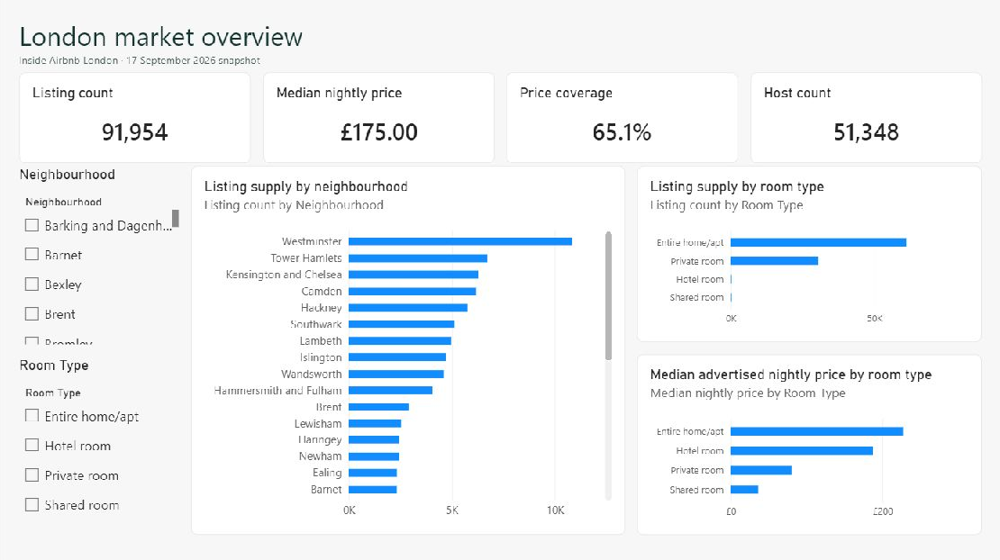
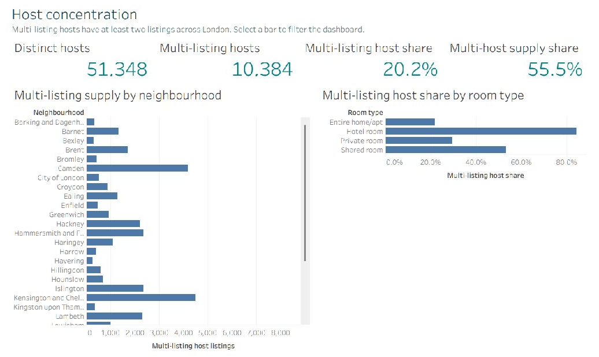
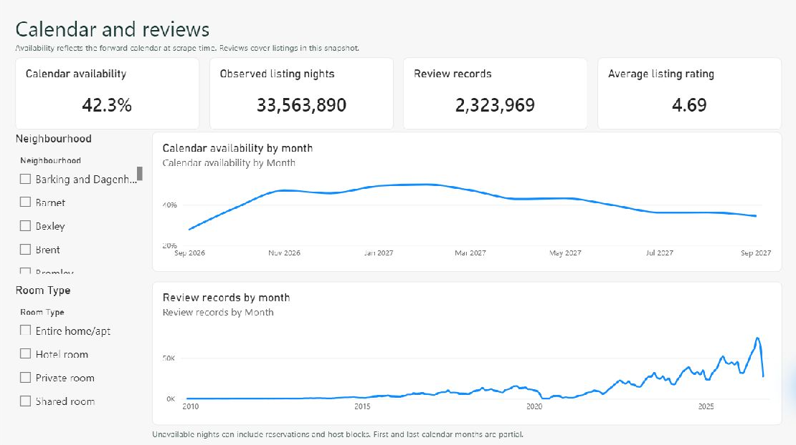

# London Short-Term Rental Market Intelligence

**Market snapshot · 17 September 2026**

This case study examines where London’s Airbnb listings are concentrated, how advertised prices vary by room type, and how much supply is associated with multi-listing hosts. The Power BI and Tableau dashboards let readers explore those questions by neighbourhood and room type.

## Market supply and advertised prices

The snapshot contains **91,954 listings across 33 neighbourhoods**. Westminster had the most listings (10,825), followed by Tower Hamlets (6,723), Kensington and Chelsea (6,271), and Camden (6,178). Entire homes and apartments made up **66.4%** of the snapshot, and private rooms made up **33.1%**.

| Room type | Listings | Usable prices | Median advertised nightly price |
| --- | ---: | ---: | ---: |
| Entire home/apt | 61,074 | 40,521 | £227.00 |
| Private room | 30,471 | 19,085 | £80.00 |
| Hotel room | 207 | 134 | £187.50 |
| Shared room | 202 | 165 | £36.00 |
| **London** | **91,954** | **59,905** | **£175.00** |

The London median covers **65.1%** of listings. Compare prices within room types and show the priced count alongside each median, especially for hotel and shared rooms, where the samples are small.

## Host concentration

Of **51,348 hosts**, **10,384** had two or more listings in the London snapshot. They represented **20.2%** of hosts and accounted for **50,990 listings (55.5%)**. Westminster led both total listings and listings from multi-listing hosts.

Host size is determined across the London snapshot before dashboard filters are applied. A host with listings in two neighbourhoods remains a multi-listing host when either neighbourhood is selected. Use the neighbourhood and room-type views to examine where multi-listing supply is concentrated.

## Calendar availability and reviews

The forward calendar marked **14,185,809 of 33,563,890 observed listing nights available (42.3%)**. Among full months in the extract, availability was **50.0% in February 2027** and **36.2% in both July and August 2027**. These are differences in the same snapshot’s forward calendar. Repeated snapshots at comparable lead times would help distinguish recurring seasonal patterns from differences in how far ahead hosts open or block dates.

The review file contained **2,323,969 records** for listings in the snapshot. Historical review counts describe this group of listings. A reservation and a host block can both appear as unavailable, and reviews depend on whether guests leave feedback. Occupancy and realised revenue require booking and payment data. [Inside Airbnb data assumptions](https://insideairbnb.com/data-assumptions/)

## Data preparation and validation

Inside Airbnb supplied the detailed London listings and calendar files and the summary review file. The preparation script keeps listing and host IDs as text, parses positive advertised prices in GBP, and aggregates matched calendar and review records by listing and month. Every calendar and review record in the selected files matched a listing. Calendar dates run from 18 September 2026 to 22 September 2027, with partial months at both ends. Review dates run from 21 December 2009 to 22 September 2026. [Inside Airbnb downloads and attribution](https://insideairbnb.com/get-the-data/)

Power BI relates the listing table to the two monthly fact tables. Tableau retains listing-level data for prices and host counts and aggregates the monthly facts by neighbourhood and room type. Both tools use summed available nights divided by summed observed nights. The headline figures matched in Desktop, and the private-room filter produced **40.5% availability**, **11,122,543 observed nights**, and **1,011,846 review records** in both tools.

## Dashboard gallery

| View | Power BI | Tableau |
| --- | --- | --- |
| London market overview | [Screenshot](screenshots/powerbi-market-overview.png) | [Screenshot](screenshots/tableau-market-overview.png) |
| Host concentration | [Screenshot](screenshots/powerbi-host-concentration.png) | [Screenshot](screenshots/tableau-host-concentration.png) |
| Calendar and reviews | [Screenshot](screenshots/powerbi-calendar-reviews.png) | [Screenshot](screenshots/tableau-calendar-reviews.png) |

See the [project README](../README.md) for the workbook paths and reproduction steps.
